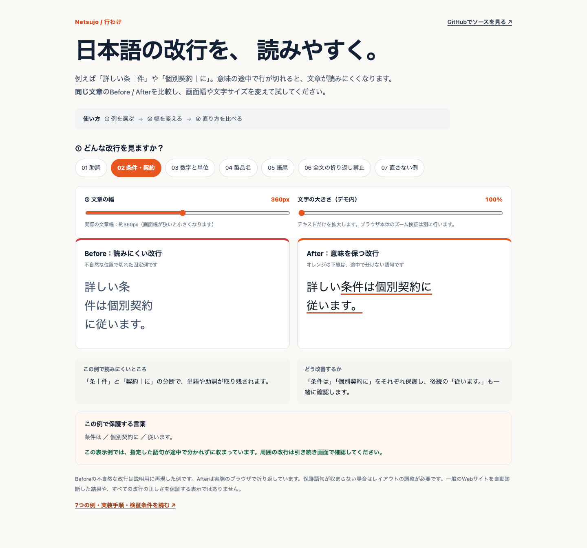
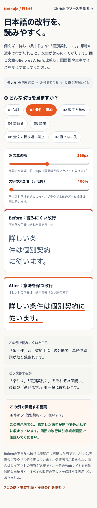

# 行わけ（Gyowake）

**日本語Webサイトの改行・段落を整えるAgent Skill。**

助詞や製品名が途中で分かれる、語尾だけが次の行へ落ちる、段落が長く読みづらい。行わけは、こうした表示をブラウザで確認し、承認済みの原文を保ちながら最小限の修正と再検証を進めるための、[Netsujo](https://netsujo.jp)製Skillです。

**公開プレビュー：v0.3.0-preview.2。** 日本語Webサイトを扱う開発者・制作担当者と、その作業を支援するコーディングエージェント向けです。修正には対象プロジェクトのソース編集権限が必要です。

[体験デモ](https://gyowake-demo.vercel.app/demo/) · [導入・更新](docs/INSTALL.md) · [7つの実例](docs/EXAMPLES.md) · [実サイトの事例](docs/CASE_STUDY.md) · [ロードマップ](docs/ROADMAP.md) · [English](README.en.md)

## デモで確認する

デモは**同じ文章**のBefore / Afterを並べ、文章の幅と文字サイズを変えられます。Beforeは説明用に不自然な改行を挿入した固定例、Afterは短い保護語句を使ったブラウザの折り返しです。実サイトの品質は、対象の実画面で確認します。



<details>
<summary>スマートフォンの表示例（390px）</summary>



</details>

## 導入する

配布物は `skills/gyowake/` です。GitとNode.js 22以上を使います。WindowsではGit BashなどのPOSIX形式のシェルを使用してください。

```sh
git clone --depth 1 https://github.com/netsujo-inc/gyowake.git
cd gyowake
npm test
```

続いて、使うホストに対応する片方を実行します。既存の導入先がある場合は、[更新手順](docs/INSTALL.md#更新する)へ進んでください。

`~/.agents/skills/` を読むホスト向け：

```sh
(
  set -eu
  target="$HOME/.agents/skills/gyowake"
  test ! -e "$target"
  test ! -L "$target"
  mkdir -p "$target"
  cp -R skills/gyowake/. "$target/"
  test -s "$target/SKILL.md"
)
```

Claude Code向け：

```sh
(
  set -eu
  target="$HOME/.claude/skills/gyowake"
  test ! -e "$target"
  test ! -L "$target"
  mkdir -p "$target"
  cp -R skills/gyowake/. "$target/"
  test -s "$target/SKILL.md"
)
```

ホストの手順でSkillを再読込し、`name: gyowake` が読まれたことを確認します。ファイルのコピー成功と、ホストでの読込成功を別々に確認してください。

## 使う

最初は、URL・幅・変更権限を含めて監査を依頼します。

> このLPを行わけで監査してください。画面幅375pxで助詞・複合語・数字と単位・段落を確認し、不自然な境界と原因、最小修正案を示してください。ソースはまだ変更しないでください。

修正を依頼するときは、原文維持と再検証まで指定します。

> 指摘箇所を、承認済み原文を変えずに修正してください。既存の短い語句保護コンポーネントを優先し、320・375・768・1024・1440pxで再表示してください。修正前後の行、横はみ出し、検証した版と未検証範囲を記録してください。

| モード | 行うこと | 必要な権限・環境 |
| --- | --- | --- |
| `audit` | 実表示を調べ、指摘と修正案をまとめる | 読取権限とブラウザ |
| `fix` | 原文を保持してソース・レイアウトを修正する | 対象プロジェクトの編集権限 |
| `verify` | 指定した版を再表示し、境界とレイアウトを確認する | 読取権限とブラウザ |

公開・デプロイ・削除の権限は、利用するプロジェクトの承認手順に従います。

## 判断の例と限界

`詳しい条｜件は個別契約｜に従います。` なら、`条件は`・`個別契約に`・`従います。` などの短い意味単位を検討し、隣接する行も読み直します。段落は話題や意味の切り替わりを基準に検討します。

自動処理の範囲は、指定された保護語句を使う分割、固定例の表示、任意で導入するBudouXによる境界候補の提示です。意味の判断と実画面の最終確認はレビューが必要です。

| 状態 | 扱い |
| --- | --- |
| 意味や候補境界の判断が必要 | `NEEDS_REVIEW` |
| 最短の保護語句も幅に収まらない | `NEEDS_LAYOUT_CHANGE`。許可された幅・余白・列構成の変更を検討 |
| 保護語句が収まる | その表示例の限定結果。周辺の行・段落も確認 |

文字を隠す・切り詰める・自動で縮小する・単語の途中で分ける修正は避けます。ブラウザ、フォント、画面幅、ネイティブズーム、WCAG適合、サイト全体の品質は、それぞれの対象に合った検証が必要です。

## テストとローカルデモ

```sh
npm test
npm run demo
# http://127.0.0.1:8765/skills/gyowake/demo/ を開く
```

デモサーバーにはPython 3が必要です。標準テストはNode.js組込み機能で動作し、外部通信を行いません。デモ内の100〜200%文字拡大と、ブラウザ本体のズームを区別してください。

## BudouXを任意で試す

希望する場合だけ、別の作業用checkoutへ固定版を導入します。候補は常に `NEEDS_REVIEW` として扱います。

```sh
npm install --no-save --package-lock=false --ignore-scripts --no-audit --no-fund budoux@0.9.3
printf '%s' 'Netsujo SIGNALで相談につながるサイトを作る。' |
  npm run gyowake:suggest -- --protect 'Netsujo SIGNAL'
```

自動インストールや外部テキストAPIへの送信は行いません。[由来・固定比較・制約](skills/gyowake/references/budoux.md)を確認してください。

## 旧名称からの移行・ライセンス

2026年10月21日にKaigyoから行わけ（Gyowake）へ改名しました。旧GitHub URLは新リポジトリへ転送されます。導入済みの旧Skillやサイト内参照は、[移行手順](docs/INSTALL.md#旧kaigyoから移行する)を確認して切り替えます。JavaScriptの `KaigyoCore` は移行用の互換エイリアスを保持します。

`package.json` は `private: true` を維持しており、npmには公開していません。CLIはソースcheckoutから実行できます。

MITライセンス、著作権者はNetsujo株式会社です。BudouXはApache-2.0の外部依存で、ソース・モデル・学習データを配布物に同梱していません。[第三者ソフトウェア](THIRD_PARTY.md) · [貢献方法](CONTRIBUTING.md) · [変更履歴](CHANGELOG.md) · [Skill正本](skills/gyowake/SKILL.md) · [名称の一次調査](docs/NAME_REVIEW.md)
