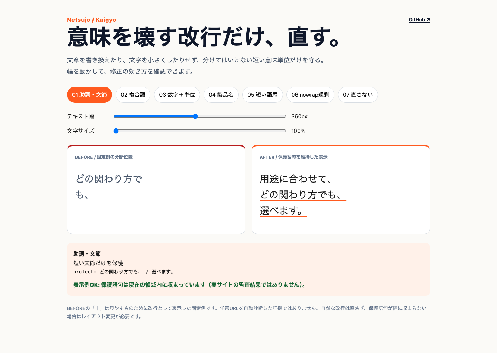
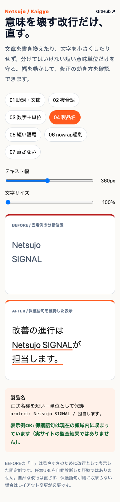

# Kaigyo

**Japanese web line-break and paragraph QA for coding agents.**

Kaigyo helps developers audit, minimally repair, and verify awkward Japanese wrapping and paragraph rhythm while preserving approved visible copy. It is a reusable **Agent Skill** by [Netsujo](https://netsujo.jp).

> **Public preview — v0.3.0-preview.1.** The Skill provides a review workflow with tests, examples and a local demo. Final acceptance for a real website requires source access (for fixes), an actual browser, and evidence for the exact page/version tested. It does not automatically classify arbitrary websites or guarantee perfect line breaking.

## Live demo and screenshots

**[Open the Kaigyo interactive demo →](https://kaigyo-demo.vercel.app/)**

Adjust the content width and font size to compare fixed *BEFORE* examples with rendered *AFTER* text. The before cases are synthetic fixtures; page-specific audit accuracy is evaluated separately.



<details>
<summary>View mobile demo screenshot (390px)</summary>



</details>

See **[7 Before/After cases, implementation guidance, and automatic-judgment limits](docs/EXAMPLES.md)**.

## What it checks

- Detached particles, sentence endings and bunsetsu; broken names and numbers with units.
- Unnatural forced line breaks, whole-paragraph `nowrap` and horizontal overflow.
- Missing semantic paragraph boundaries and unnecessarily fragmented paragraphs.
- Mobile widths, responsive behavior and 200% text enlargement when required.
- Preservation of the complete visible copy and adjacent line context.

For example: `個別契｜約` → protect `個別契約`; `30｜分` → protect `30分`. Ordinary Japanese line wrapping remains permitted.

## Install as an Agent Skill

The complete distributable Skill is `skills/kaigyo/`. Copy that directory as-is into an Agent Skills directory supported by your coding agent:

```sh
git clone https://github.com/netsujo-inc/kaigyo.git
mkdir -p ~/.agents/skills ~/.claude/skills
cp -R kaigyo/skills/kaigyo ~/.agents/skills/kaigyo
# For Claude Code instead (or additionally):
cp -R kaigyo/skills/kaigyo ~/.claude/skills/kaigyo
```

Follow your agent's skill discovery/reload procedure. The host agent retains file access, editor authority, security policy, deployment authorization, and final judgment.

Example request (Japanese):

> このLPをKaigyoで監査して。画面幅375pxの不自然な改行と段落を特定し、原文を変えずに修正案と検証証拠を示して。

### Three modes

| Mode | Operation | Permissions |
| --- | --- | --- |
| `audit` | Browser-observed findings and proposed minimal repairs | Read-only |
| `fix` | Authorized source/layout edits plus regression checks | Existing source-write permission required |
| `verify` | Re-render and validate an exact version | Read-only |

The Skill never grants publishing, deploying, deleting, or production-change permission.

## Run the local tests and demo

Requirements: Node.js 22+; Python 3 for the static demo server. Default tests use only built-in Node.js modules and make **no network calls**.

```sh
npm test
npm run demo
# Then open http://127.0.0.1:8765/skills/kaigyo/demo/
```

The demo uses seven fixed examples, adjustable content width, and adjustable 100–200% font size. Its status refers only to the selected example. It is not a real-website acceptance test.

## Optional BudouX candidate review

BudouX can suggest potential phrase boundaries **for human review only**. Kaigyo does not install it automatically, call external text APIs, rewrite the DOM, or treat a predicted break as a verified repair.

```sh
# Optional, in an isolated local checkout:
npm install --no-save --package-lock=false --ignore-scripts --no-audit --no-fund budoux@0.9.3
printf '%s' 'Netsujo SIGNALで相談につながるサイトを作る。' |
  npm run kaigyo:suggest -- --protect 'Netsujo SIGNAL'
```

Outputs remain `NEEDS_REVIEW`. See [BudouX provenance and limitations](skills/kaigyo/references/budoux.md).

## Acceptance and limitations

Real-site verification must record browser/version, viewport, content width, exact source identity, visible before/after lines, screenshot or equivalent geometry, overflow checks, and tests. Recommended viewport widths: **320, 375, 768, 1024 and 1440 CSS px**, plus the observed failure width. Normal viewport reduction is not equivalent to every native 200% text-resize test.

If the shortest protected phrase cannot fit, return `NEEDS_LAYOUT_CHANGE`. If semantics are uncertain, return `NEEDS_REVIEW`. Do not shrink/hide text or claim a pass from source-only inspection.

Kaigyo is a source-access and browser-review workflow. It has no hosted crawler, no paid API and no customer-content upload path. For project-specific details consult [the canonical Skill](skills/kaigyo/SKILL.md).

## Contributing and licensing

- [Contributing](CONTRIBUTING.md) | [Changelog](CHANGELOG.md)
- MIT-licensed original Kaigyo files, copyright © 2026 Netsujo株式会社.
- Optional BudouX is independent third-party software under Apache-2.0 and is **not vendored or redistributed** by this repository. See [Third-party notes](THIRD_PARTY.md).
- Source owner: [Netsujo](https://netsujo.jp). Issues and pull requests are welcome; do not include private customer pages or secrets in reports.

日本語：Kaigyoは、助詞や製品名の不自然な分断、段落の過不足、狭い画面での横はみ出しをブラウザ実測で監査・修正・再検証するAgent Skillです。承認済み原文を維持し、実ページの最終受入にはブラウザ証拠が必要です。
